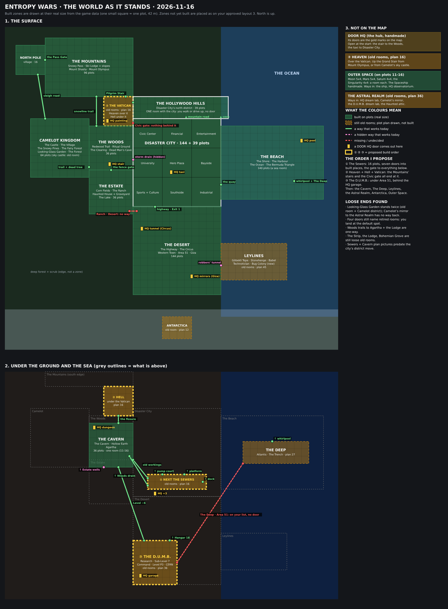

# Entropy Wars — where the world stands after 2026-11-16

For review by the other collaborator and the project head. Written by the coordinating thread on the second account, at
main `7c4e792` (PR #1867), after every thread it started had stopped. Open questions for mondo are in section 9.

**How to read the claims in this file.** "Built", "live" and "seen" mean a thread merged it, uploaded it and looked at
its own pictures in a cloud browser. **Nobody has walked any of today's work in a real game on a real machine.** The
coordinating thread did not look at the districts' pictures itself; it checked the room and door data directly
(`load-data.js`) and took the rest from each thread's notes and board row. Where a thread admits a gap, it is listed.

---

## 0. The state in one page

- **Every zone is on plots now.** 22 plot-built rooms plus Disaster City. Only DOOR HQ and the Spaceship stay
  handmade, as planned. This morning eight zones were still old handmade rooms.
- **Every zone is split into districts with one file each**, so threads can work side by side. About 95 districts.
- **About 40 districts have had a real build-up** (three to eight passes each; 28 of them also a pass placing the
  new models); the rest are first build only.
- **246 new models** were made from the districts' wish lists, are in the catalogue, and were placed.
- **The door graph is sound on the big things:** no door leads to a missing room, and every live zone room can be
  reached from DOOR HQ. Nine doors still name a retired room and land at a default spot (section 5).
- **The biggest unknowns:** frame rate on a real machine (every number today is from a software renderer at 0.2 to
  3 FPS), and whether the new zones play (nothing was walked or fought in).
- **Roughly 320 pull requests** reached main during the day (#1549 to #1867, all threads on both accounts).

---

## 1. What was done, in order

| # | What | Result |
|---|---|---|
| 1 | **World survey** | `docs/notes/world-layout.md` + the map: every zone, how it is reached, the door check, the zone order. |
| 2 | **The Hollywood Hills joined Disaster City** (mondo: "the whole point is to be able to look over the city") | One room; the Hills are the city's district N on 36 new rows to the north. Two links deleted, the old Hills room retired. |
| 3 | **The Sewers built on plots** | One room under the city, 6 x 5 plots, five districts, rebuilt four times on mondo's comments (falls of 7 m, barrel vaults, murky water). Old four rooms retired. |
| 4 | **NPC spawn system for Disaster City** | Deliveries 1 and 2 live: fixed levels per district and tier (no scaling with the player), and variants (84 residents where 44 stood). |
| 5 | **One file per district in every built zone** (mondo: "every single zone needs to be like that. now.") | Woods, Camelot, Desert, Estate, Mountains, Beach split; baked rooms unchanged. |
| 6 | **A second district thread per zone**, then **every remaining district** while mondo slept | 24 district threads, each up to five passes (exteriors, interiors, dressing, atmosphere, polish), judging their own pictures. Rules: `docs/plans/DISTRICT_THREAD_BRIEF.md`. |
| 7 | **The model wish list** | 245 asks collected (`docs/plans/MODEL_WISHLIST.md`); mondo had 246 made (`docs/plans/WISHLIST_MODELS_ADDED.md`). |
| 8 | **The model pass** | Every district thread placed its models and took out the stand-ins. 28 districts did it. |
| 9 | **The eight old zones redesigned on plots** (mondo: "completely redesigned/reimagined ... like we did for disaster city or Camelot") | Heaven + Hell + Vatican, the D.U.M.B., the Cavern, Leylines, The Deep, the Astral Realm, Outer Space, Antarctica: each a new layout, a bake tool, district files, exits moved, old rooms retired, one pilot district. Rules: `docs/plans/ZONE_THREAD_BRIEF.md`. |
| 10 | Also on 11-16, by other threads on mondo's direct word | The Shore copied onto the city's north beach (step 1 of joining the Beach to the city); the wide boardwalk; new land edges past each zone's line and a cove; a renderer fix for the Christmas-pack trees. |

---

## 2. Every zone

Room ids drop the `site_prebuilt_` prefix. "Pilot" = the district taken furthest.

| Zone | Room(s) | Plots | Districts | State |
|---|---|---|---|---|
| DOOR HQ | 148 handmade rooms | | | Handmade, unchanged today. Owner side. |
| Disaster City | `downtown_streets` | 144 + 39 (Hills) + the north beach | 9 city districts, N The Hollywood Hills, W the Shore copy | City districts: owner side, untouched. Hills: 5 passes + models. |
| The Woods | `fairy_forest_plots` | 36 | M Dead Man's Cave (pilot), T Redwood Trail, C The Clearing, G The Ritual Ground | T, C, G: 5 passes + models. M: 3 passes, held by its pilot. |
| Camelot Kingdom | `camelot_kingdom`, `camelot_palace` | 64 | K Castle (owner), T Village (pilot), F Fairy Forest, N Snowy Pines, W Forest, L Looking-Glass Garden | All but K: 4 to 5 passes + models. Sky castle still an old room. |
| The Mountains | `shasta_mountains`, `northpole_plots` | 96 + 16 | N North Pole (pilot), P Snowy Pass, K Ski Lodge, O Olympus, S Shasta | P, K, O, S: 5 passes + models. N: 8 passes, held by its pilot. |
| The Estate | `skinwalker_estate` + the Haunted House's 5 floors | 36 | H Haunted House (pilot), L Lake, C Corn Fields, R Ranch | L, C: 5 + models. R: 4 + models. H: 4, held by its pilot. |
| The Desert | `area51_desert` + Hangar 18, inside the Great Pyramid | 144 | R Highway, C Circus, W Western Town (pilot), A Area 51, G Giza | C, W, A, G: 5 passes + models. |
| The Beach | `bermuda_beach` + the Dutchman's 4 decks | 140 | S Shore (pilot), H Harbour, O Ocean, T Bermuda Triangle | H, O, T: 5 + models. The Shore now stands TWICE (section 5). |
| The Sewers | `downtown_underworld` | 30 | W Sewers, T Running Tunnels, H Holding Cells, O Old Workings, R Radioactive Drain | W, T, H, O: 5 + models. R: 2 + models. |
| The D.U.M.B. | `dumb_base` | 49 | K CERN the Ring, P Level P3, S Sub-Level 7 (pilot), R Research (+ the White Rooms), C Command | NEW today. Pilot: 3 passes. Others first build. |
| The Cavern | `hollow_earth_cavern` | 36 | K The Cavern (pilot), H Hollow Earth, A Agartha | NEW today. Pilot: 4 passes. |
| Leylines | `gobekli_ancient` | 63 | S Stonehenge (pilot), G Göbekli Tepe, B Bug Colony (new), Y The Ley Line, T Babel, Z Technoticlan | NEW today. Pilot: 5 passes. |
| The Deep | `atlantis_deep` + `atlantis_pocket` (the Temple's dry inside) | 40 | C Citadel (pilot), R Rings, S Sea Floor, T Trench | NEW today, under water. Pilot: 3 passes. |
| Heaven + Hell + Vatican | `vatican_plots`, `vatican_under`, `hell_plots`, `heaven_plots` | 24 + 6 + 16 + 20 | 14 districts; pilot B the Basilica | NEW today. Pilot: 4 passes. |
| The Astral Realm | `lookingglass_realm` + the Waiting Room (handmade) | 36 | S Sea of Possibility (pilot), L Library, N Nightmare | NEW today: 36 floating islands. Pilot: 4 passes. |
| Outer Space | `moon_plots`, `mars_plots`, `saturn_plots`, `singularity_plots` + the Spaceship (handmade) | 20 + 20 + 16 + 16 | 10 districts; pilot M the Moon's Mare | NEW today: a room per world. Pilot: 3 passes. |
| Antarctica | `antarctica_plots` | 36 | S Station (pilot), H Hull in the Ice, W Ice Wall, C Crevasse, O Polar Openings, F Shelf Ice | NEW today. Pilot: 3 passes. |

**Still old handmade rooms, not folded in** (checked in the data): the Strip (streets, chapel, casino), Cyberpunk City
(streets, noodle bar), the Lodge, Bohemian Grove, the old Looking-Glass Garden, Camelot's sky castle, the stadium bowl
and the city's mall / lobby / showroom / platform insides. The first five are loose ends; the rest are meant to be insides.

---

## 3. What the redesigns did (the eight new zones)

| Zone | The idea of the redesign | Biggest choices made without mondo |
|---|---|---|
| The D.U.M.B. | One base in a ring on three levels; CERN is the outer ring; the White Rooms came down whole from Area 51 | One room, not six. The Pit is empty with a flesheater in it. Plain room labels. |
| The Cavern | One room so the Inner Sun is seen from the cave: a three-tier cave loop, Hollow Earth below, Agartha's terraces round the Spire | Agartha is a district here now. Four old side links dropped. A new return door to the Woods. A new renderer feature: up to four big "sun" lights a room. |
| Leylines | The old tunnel maze became one straight glowing road on the surface with each ancient site at the end of a fork; Technoticlan is an island city; Bug Colony added | Stonehenge's axis faces south. No visitor centre. The plan's three new insides were not built. |
| The Deep | Atlantis as Plato's ring city (island agora, two canals, two rings, a marble wall), sea floor west, trench east; you swim from the first frame | The Temple of the Deep stands on the Agora; its dry inside is a new room. Causeways are solid banks. |
| Heaven + Hell + Vatican | The Vatican laid out like the real one (a 112 m basilica, the oval square); the Catacombs a dungeon under it; Hell one funnel to a lava sea; Heaven one climb to a cloud city | Four rooms, 66 plots (the guess was 48). The city gate faces east and is closed. Hell has an open red sky. |
| The Astral Realm | No ground: every plot is a floating island at its own height, joined by cloud bridges; the Library climbs, the Nightmare sinks | "A full redesign he has NOT seen yet" (its own board row). The Camelot mirror is two-way now. |
| Outer Space | A room per world, heights are the map (a 70 m crater, the Face as a mesa, Saturn a true hexagon, the Singularity a bowl) | The plan's one solar system was dropped because flying is a new mechanic. The Far Side has a saucer, a dig and a film sound stage. |
| Antarctica | South to north: shelf ice, station, crevasse, a 35 m Ice Wall with one gap, the hull behind it | The Spaceship's collar moved behind the Ice Wall. No story gate. Station people are Men in Black. |

Each zone thread sent mondo its plan picture and built without waiting, as he asked. Antarctica's and the Astral
Realm's notes say plainly that he has not answered or seen them.

---

## 4. Live, and how far it was checked

| Claim | Checked how | Not checked |
|---|---|---|
| Rooms, plots, doors, retired rooms | The coordinating thread loaded the real data and walked every door | |
| Each district's look | Its own thread, from probe screenshots in a cloud browser (software renderer, post effects off) | No one on mondo's machine. Night and "post on" looks unseen in several zones (The Deep says so outright). |
| Walking | Bake tools' offline walk checks | **No zone or district was walked by a player.** Stated by the Sewers, the D.U.M.B., the Cavern, Antarctica, the Vatican, Leylines, Outer Space, the Harbour, the Holding Cells. Built structures (wharf, gantry, ladders, the Vent) are outside those checks. |
| Fights | | **No fight was played anywhere new.** The Sewers' new liquid was never fought on. Most new zones still use a default or old encounter table. |
| People | Placed in data | Several threads never saw their people on screen (the probe draws no cast); some saw the wrong figure standing there (section 5). |
| Frame rate | Before / after counts on the cloud's software renderer | **Every FPS number today is 0.2 to 3.3 on llvmpipe.** Threads call it noise ("it measures the container, not the room"). No real-GPU number exists for anything built today. |
| Online play | | Not looked at. Room data only, except the Sewers' sludge liquid, which touches battle code. |

---

## 5. Known problems and risks

Ranked by how much they could hurt.

### 5.1 Frame rate is unknown, and the scenes got much heavier
- Draw calls roughly doubled in most districts over the passes; model passes added more. Worst read: Camelot's Forest,
  3,787 to 4,924 draw calls on one view. The Harbour view holds 4.0 M triangles; the Ocean's Landing 4.1 M.
- **The Ocean room has no far cull**: "the room draws nearly everything from anywhere". Its triangles went up "more
  than their sum, so something near it draws them several times over". Leylines saw the same kind of doubling.
- Some single props are enormous: the loose bone props (`skull`, `femur`, `ulna`) are about half a million triangles
  each; six of them took a room from 0.7 to 0.1 FPS. The `rat` is 21,754 triangles for a 12 cm animal.
- The Hills cost the city frame rate (1.6 to 0.9 on one view) until its scatter was cut by a third.
- One hearth fire with a real light took the Ranch from 883 to 2,731 draw calls ("the hero-light trap"); fixed there,
  but it applies to any walk-in hearth.
- The city was about 37 FPS on mondo's Mac before today and a friend plays on a weak Chrome PC. **This needs his F3
  readings before more is added.**

### 5.2 Ten real lights per room, and the new lamps do not glow
- A room has ten real lights. Districts compete for them and do not agree who has which (the Sewers' two accounts
  differ; in the Cavern one district holds all ten; The Deep has 26 lit props and never tested the limit).
- `lantern_post`, `iron_lamp_post` and `string_lights` came without a glow. At least eight threads each drew their own
  flame or sleeve. The Clearing's trail and the Circus's bunting ended up **darker** at night than before.
- On Olympus every brazier became a `tripod_bowl`, so the district lost its real lights.

### 5.3 Things standing twice, and old rooms not retired
- **The Shore exists twice**: in the Beach room and, since today, on the city's north beach. Step 2 (move the Harbour
  and the Dutchman, strip the sea room to open ocean) is not started. An edit to the Shore's file needs both bakes.
- **The old Looking-Glass Garden room** still stands beside Camelot's district; the HQ barbershop mirror, Camelot's
  `oldgarden` gap and the Looking-Glass bay door still open on it.
- **Bohemian Grove** and **the Lodge** still stand as old rooms; the Ritual Ground now holds the Grove's content.
- **The Strip** and **Cyberpunk City** are still places joined to the city. The Sewers dropped their two sewer links
  on mondo's word.

### 5.4 Doors
- **Nine doors still name a retired room.** The game sends you to the new room's default spot, not the matching door:
  HQ dungeon and HQ `ritual`; the Woods' `lemuria` trail; the city's and old Downtown's `sewer` doors; old Downtown's
  `harbour`; the sky castle's `keep` and `chimney`; the old Garden's dead-tree door.
- **One-way ways:** the Cavern's new `woods` and `dungeon` doors (their far ends are the other account's and were not
  changed); the Woods' `lodge` trail; Camelot's `oldgarden`.
- **The Vatican's gate into Civic Center** is built closed on the Vatican side; nothing exists on the city side.
- The eight zones were redrawn at the same time. Every shared link has both ends on the new rooms in the data, but
  the walls do not mirror (the Cavern's north wall meets Hell's west wall; Antarctica's two ways down cross over), and
  the board notes describing them are stale.
- One HQ door arrives at a door id that does not exist (`records.tapes`), unchanged since the morning.

### 5.5 Placeholders, stand-ins and wrong models still in
- Drawn in code because no model exists: the Circus's Big Top and stalls; the Basilica's organ, baldachin and vaults;
  the Vatican's obelisk; the Cavern's Inner Sun, Spire and stalactites; the Astral Closet and Stacks; Atlantis'
  causeways; the Ocean's waterspout; lily pads; several bridges that are solid ground dressed as a bridge.
- Models that draw wrong: `olive_tree` leaves ("grey shards with black backs"); `ocean_rock_*` and `psxg_rock_*`
  (black or grey cubes on land); `white_cloud` ("a heap of grey stones"); `lion_statue` (a live lion); `beer_taps`
  ("a giant teapot"); `ebd_metro_turnstile` (a grey block); the pink `PlasterWallPainted1c`; `holy_carpet` stands upright.
- Wrong figure standing: the Snowy Pines' residents drew as "a blue woman" and "a dark insect figure"; Camelot's
  Forest had "a blue winged figure" on the rabbit's spot.
- The tool's scatter drops stones or snags on paths in three zones (Western Town's Main Street, the Corn Fields'
  tracks, the Circus grounds).

### 5.6 Things that were added without being asked for
mondo's rules say no invented names, characters, rules or mechanics. These went in and need his eye:
- **A new battle liquid, `sludge`** (the Sewers' Radioactive Drain): move cost 2, heals halved, ending a turn in it
  gives Corroded for 2 rounds, flyers spared. mondo asked for a corroding liquid; the numbers are the thread's, it
  touches ten game files including battle, AI and state code, and no fight was played on it.
- **Units added to places with no lines:** well over 60 across the day (the Circus 8, the Garden 5, Camelot's Forest 5,
  the Ranch 3, the Snowy Pines 3, Olympus 6, Shasta 7, Outer Space 10, and more). Camelot's encounter table was split
  and four races added at a weight the thread picked.
- **Buildings and scenes nobody named:** Western Town's five extra trades; a moon-landing film set on Area 51's dry
  lake and another on the Moon's far side; a saucer with a corpse hidden in the corn; queens' pyramids; a tennis court
  at a Hills villa; several walk-ins "with no game role" (ranger station, Camp House, Glasshouse, Field Shed).
- **Horror dressing** in the Woods and Estate (wrapped corpses, body parts, traps) beyond what the old rooms had.
- **Engine and tool changes made from district threads**, each affecting more than its district: the crowd cap for
  every plot-built outdoor room (up to 14 bodies); a fix moving every Christmas-pack tree in the game; chain-link wall
  drawing in every room; new renderer features (ground zones, big "sun" lights, petal material, tree kinds, the
  waterfall row, chimney smoke); `airZones`, `ground` and other hooks in six bake tools.
- **Labels the threads wrote:** dozens of plain plot names and sign words. Each thread marked them as its own.

### 5.7 Housekeeping damage from thirty-odd threads merging at once
- **FIXED later on 11-16: `docs/notes/areas-complexes.md`** (the bad merge had doubled about 3,500 lines, 45 sections). Each pair
  was merged line by line keeping the union; where one copy had the newer wording of the same line (mostly NEEDS A MODEL lists
  crossed off by the model passes) the newer one stayed. The Old Workings' (Sewers O) passes that sat under the Snowy Pass and
  an old copy of the Harbour's decisions under the Looking-Glass Garden were taken out (both stand whole in their own sections).
- **FIXED later on 11-16: `docs/notes/claims.md`** duplicate rows (Mountains P, K, O, S; the Hills; three Beach rows; the Deep and
  afterlife tool rows; the Basilica): the newest row of each stays. Stopped rows still read `free` in some zones and `second` in others.
- **One build reached main without its room**: the Cavern's first PR took main's data.js on a conflict and the rebake
  failed unseen; the next PR fixed it. The same helper is used by every thread.
- **Two PRs were merged by the wrong thread** (a typed number): the Hills' #1691 and the Ranch's #1800. Both threads
  say no content changed.
- **Old tapes and finds** were mostly not re-homed when rooms were retired (allowed by the house rule; listed so
  nobody is surprised).
- **No sound** was added anywhere. Every thread lists it.

---

## 6. The NPC spawn system (Disaster City)

mondo's order: no level scaling with the player, many of the same unit, rarity tiers up to one-of-a-kind, district
caps that refill after captures, random zodiac signs, and later an easy sheet for boss and scripted fights.

| Delivery | State |
|---|---|
| 1. Fixed levels per district and tier | **Live.** Bases: Bayside 5; Entertainment, Industrial, Hero Plaza 15; Financial, Sports 25; Civic, University, Southside 35. Uniques: Sidekick 45, Antihero 48, Superhero 50, King Kong 50. Every number is a proposal he has not set. |
| 2. Variants | **Live.** 84 residents where 44 stood (7 cops, 7 chefs and so on); Superhero male and female are two rows. Still 8 bodies drawn (4 on a weak PC). |
| 3. Cap per district + refill (about 3 in-game days) | Not built |
| 4. The holding tank in DOOR HQ ("like the Pokemon box") | Not built; DOOR HQ is the other account's, and no note has been left for it yet |
| 5. Zodiac per NPC | Not built |
| 6. The boss / scripted battle sheet | Not built |
| 7. Spontaneous events (a mugging, a drive-by, about once an hour) | Not built |
| 8. The blueprint for other zones | Not written |

Notes: `docs/notes/npc-system.md` (its header still says deliveries 2 to 8 are unbuilt: stale).

---

## 7. The board

**Second account (this one):** every district and tool row named in sections 2 and 3, the Sewers, the eight new
zones, the NPC system, the first-quest cutscenes, the city's frame rate, the trees. Three pilot threads still hold
rows without having stopped: the Haunted House (4 passes), Dead Man's Cave (3), the North Pole (8).

**Owner account (mondo's project):** Disaster City's nine districts and its tool, Camelot's Castle and palace, DOOR HQ.

**Done in the owner's areas today, on mondo's direct word** (each has a dated note at the bottom of `claims.md`):
- The Hills: a new city district file, a batch of changes in the city's bake tool, two links deleted, a traffic row.
- The Shore copy: a new city file `W.js`, the city's beach file widened and reworked.
- The cove cut into the city's north-east corner; edge drawing changed for every room.
- The Woods and Camelot were split into district files though their rows said `owner` (rooms byte for byte the same).
- The NPC thread changes the city's residents list.

**Requests waiting for the owner account:**
1. Make the two approved Civic Center models (seated statue, blossom tree); the district file already places them.
2. A road sign for the Desert at the city's south way out.
3. Keep one yard square free at the Power station (the Sewers' new door stands there), or say where it should go.
4. Open the Civic Center west gate to the Vatican: one link row, then tell the board.
5. A grey untextured mass under two of the castle hill's corner drums: the castle's or the tool's?
6. Point the Woods' `lemuria` trail at the Cavern's new return door.
7. (Optional) tidy the DOOR HQ dungeon door that still names the old oubliette.
8. A new DOOR HQ room for the NPC holding tank (not yet asked on the board).

---

## 8. Models

- **Made and placed:** 246 (`docs/plans/WISHLIST_MODELS_ADDED.md`), in the editor under "Meshy props · wish list".
- **Not made:** papyrus, whale bones, gold pile, wheat patch.
- **Made but with a problem:** the lantern, lamp post and string lights have no glow; the olive tree's leaves; the
  rat's weight; the kennel's and lantern post's facing need a look.
- **Second wish list, from the eight new zones (not collected into one file yet):** about 150 more. The big ones:

| Zone | Wants most |
|---|---|
| The Cavern | A cave rock wall kit, stalactites, living dinosaurs, the Inner Sun, the Spire, crystal houses |
| Heaven + Hell + Vatican | Saints' statues, a baldachin, a pipe organ, white cloud puffs, white towers, an obelisk |
| The D.U.M.B. | A particle detector, clone vat, war-room table, base tram, round blast door |
| Leylines | Sarsen and lintel stones, a hive kit for the Bug Colony, a lamassu, a skull rack, a stone hoop |
| The Deep | A whale skeleton, a colossus, a trireme wreck, an arched bridge span, coral |
| Outer Space | A lunar rover, a flag, habitat modules, a monolith, a rock arch, ring ice |
| The Astral Realm | The Maw, the Closet, bookcase towers, a giant bed, more thought-forms |
| Antarctica | An icebreaker, a snowcat, penguins, icebergs, hull plating |

- **Not models, still open:** ground and wall sheets (snow, bark, black sand, clay roof tiles, graffiti, hieroglyphs,
  mosaic, coral); a mist air kind; an ice kind for the land edges; an Earth in the Moon's sky; light shafts.

---

## 9. Open questions for mondo

**The big ones**
1. **Frame rate:** will you take F3 readings in the city (Casino court, the Hills' terrace), the Beach (the Landing,
   the Harbour quay) and two or three new zones, on your Mac and your friend's PC? Nothing more should be added to
   the heavy rooms until those numbers exist.
2. **The Beach and the city, step 2:** does the Harbour (and the Dutchman) follow the Shore into the city's water, or
   does the Long Pier's end become the way out to a sea-only Beach room? Until then the Shore stands twice.
3. **The sludge liquid:** keep it as a battle rule? If yes, are "move cost 2, heals halved, Corroded for 2 rounds, no
   race immune" your numbers?
4. **The eight redesigns:** each sent you a plan picture and built on. The Astral Realm (floating islands) and
   Antarctica say you have not seen theirs. Which, if any, do you want redone before more districts are built on them?
5. **The units added without lines** (well over 60): keep, cut, or leave to the NPC system to decide who stands where?
6. **The NPC numbers:** the level per district and tier, the counts per unit, the city's top level; and raise the
   drawn bodies from 8 to 12?

**Old rooms and doors**
7. Retire the old Looking-Glass Garden into Camelot's district? (Three doors and a bay door still open on it.)
8. Retire Bohemian Grove (its content is in the Ritual Ground) and fold the Lodge into Financial, or leave both?
9. The Strip and Cyberpunk City: keep as places for now, or fold the Strip's casino and chapel into Entertainment?
10. A way between the Estate's Ranch and the Desert, or only a border?
11. Where does the Spaceship leave from, and how does the player reach it? (You said later; listed so it is not lost.)
12. The Ice Wall round the whole world: yes or no. (Antarctica kept it inside its own zone.)
13. The Vatican gate into Civic Center: open it? (The city side is the other account's.)

**Per zone**
14. *The Hills:* the letters glow at night (the real sign is unlit): keep? People in the Hills?
15. *The Ski Lodge:* should the chairlift move or carry the player (a new mechanic)? Real night lights need the
    ten-light limit changed.
16. *Shasta:* a ship in the saucer cloud ("your call")?
17. *The North Pole:* the five building boards wait your word (POST OFFICE, BAKERY, TOY SHOP, STABLE, COAL).
18. *The Ocean:* the waterspout's cloud is drawn the same way as the smoke you rejected: remove it too? The tribe
    still has no people.
19. *The Redwood Trail:* place the bats? A walkable top for the Falls so the fall "leads somewhere" (your own rule)?
20. *The Corn Fields:* corn on every bank segment, or two in three as now? The saucer and the corpse in the corn:
    keep?
21. *The Ranch:* a fifth pass after your look; stairs to the hayloft?
22. *Camelot's Village:* who lives there? (Only two gate knights stand.)
23. *Camelot's Garden:* a maze? Keep the Victorian lamp posts and hanging lanterns in a medieval zone?
24. *Giza:* should the pyramids be climbable (a zigzag stair is possible)? The King's Chamber keeps the Turning Tomb door.
25. *Western Town:* do the five added trades stay (blacksmith, barber, assay office, telegraph, undertaker)? Upper
    floors? An inside for the mine?
26. *Area 51 and the Moon:* the moon-landing film sets: keep?
27. *The Circus:* a fortune tent walk-in? Real reflecting mirrors in the Hall of Mirrors?
28. *The Sewers:* a third Metro car; a moving train and changing signals (new mechanics, listed, not built). The
    unrequested hooded statue in the Old Workings: keep? The Radioactive Drain's door up: in the Power station's yard
    (as built) or inside it?
29. *Leylines:* a visitor centre at Stonehenge? The sword in the stone in the circle?
30. *Outer Space:* the flag's picture; low gravity, flying and floating (new mechanics, listed).
31. *The Deep:* a current in the canals, a breath gauge, a darkening trench (ideas, not built)?
32. *Antarctica:* the cryo casket from the old tape is placed with nothing shown inside; the fallen satellite has no
    story. Encounter tables are yours.
33. *The Cavern:* the old Inner Sun's `elf` is not a unit today and was left out.

**Working rules**
34. The five-pass cap: each district thread has stopped. Which districts get a sixth pass, and should the three pilots
    that never stopped (Haunted House, Dead Man's Cave, North Pole) be closed out the same way?
35. Should threads keep adding walk-ins, people and scenes "that fit" when you are away, or stay to what the plan names?
36. A second model round for the eight new zones (about 150 asks): collect it into one list like the first?

---

## 10. Suggested next steps (for the reviewers to accept or change)

1. **Measure first.** F3 numbers from the real machines; then a culling and weight pass on the worst rooms (the
   Ocean's far cull, the half-million-triangle props, the rat) before any more dressing.
2. **Walk it.** One player walk through every zone's ways in and out; the door list in 5.4 is the checklist.
3. **Repair the notes and the board** (the duplicated notes file, duplicate board rows) before the next round of
   threads makes it worse; fix the merge helper that can drop a room.
4. **Close the doubles:** the Shore, the old Garden, Bohemian Grove.
5. **Give the lamp models a glow once, in the catalogue**, and settle who owns each room's ten lights.
6. **Then** the second model round and the remaining districts of the new zones.

## Where things are

| What | File |
|---|---|
| This status | `docs/notes/STATUS_2026-11-16.md` |
| The map and its script | `docs/plans/world-zones/world_state_map.png`, `draw-world-state.js` |
| The world survey and mondo's answers | `docs/notes/world-layout.md` |
| Who holds what | `docs/notes/claims.md` |
| The rules the threads worked under | `docs/plans/DISTRICT_THREAD_BRIEF.md`, `docs/plans/ZONE_THREAD_BRIEF.md` |
| Each district's passes, decisions and open items | `docs/notes/areas-complexes.md` (damaged: see 5.7) and each district file's header |
| The NPC system | `docs/notes/npc-system.md` |
| Models asked / made | `docs/plans/MODEL_WISHLIST.md`, `docs/plans/WISHLIST_MODELS_ADDED.md` |
