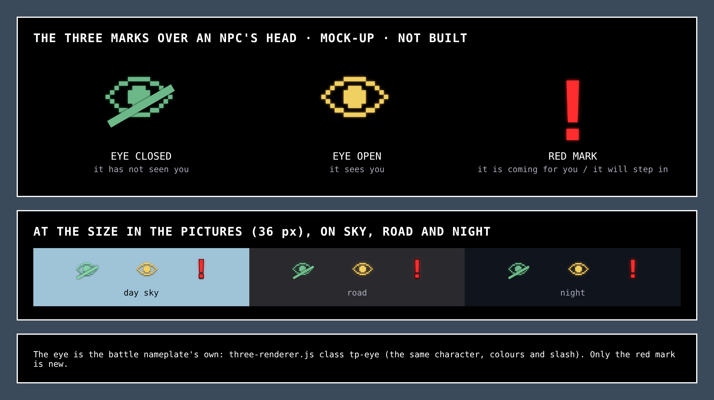
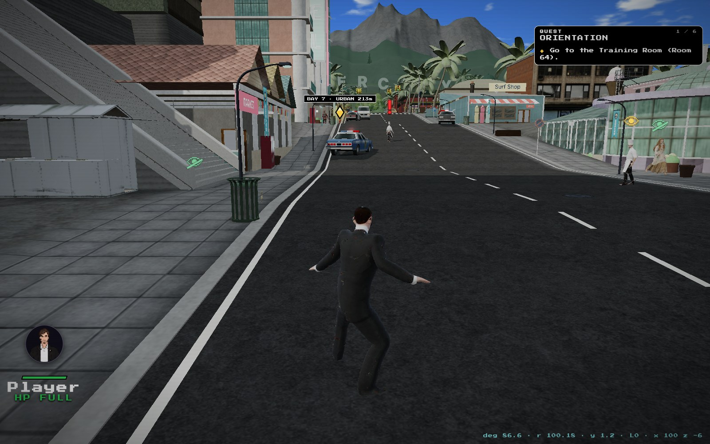
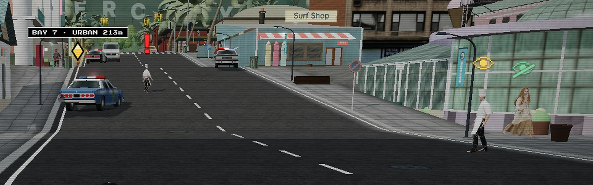

# NPC ENCOUNTERS, STEP 1A: Bayside, for mondo to mark up (2026-11-17, Fable)

Design only. Nothing here is built and no game file changed. Every row is a PROPOSAL until you mark it.
Plan: `PLAN.md` (rev 6) beside this file. Your answers of 11-17 are followed as written.

**How to mark it:** write OK, or the change, beside any row. The seven questions at the end are the ones I could not
settle from your answers; my pick is first on each.

## 0. The short version

- **Who lives in Bayside** (checked in data.js, not the plan's list): 12 people of 7 races. Chef × 2, Hippie × 3,
  Homosapien × 1, Police Officer × 2, Pirate × 2, Popstar × 1, Ghost × 1.
- **Tempers:** 7 Civilians (Chef, Hippie, Homosapien, Popstar), 2 Guards (Police Officer), 2 Opportunists (Pirate),
  1 Territorial (Ghost). No Brute, no Coward, no Protector lives here.
- **Only three people in Bayside can start a fight on their own:** the two Pirates (the mugging, mostly at night on the
  beach, where their day already puts them) and the Ghost (in the Waterfront hotel at night, after one warning).
- **The marks:** the battle's own eye, closed and open, and one red exclamation mark. Pictures in section 5.
- **A lost fight costs 8 gold × the strongest enemy's level**, never more than you hold. A Chef 40, a Pirate 72, the
  Ghost 144. A retreat costs nothing.
- **9 spoken lines** in all for Bayside, plus 7 button words.

Two things the data showed that the plan did not know:

1. **The Popstar is level 13 and the Ghost is level 18.** Bayside is "level 5 to 10" for its common and uncommon
   people only; the rare and very rare tiers sit above it. The Ghost can kill a new party.
2. **People from other districts walk through Bayside.** The picture run met a level 36 Firefighter and a level 19
   Police Officer at the Street market on their way to work. Question 6.

## 1. The tempers (plan 3.1)

Levels and places are read from `HQ_CITY_RESIDENTS` and `hqSpawnLevel` on main today.

| Unit | How many | Level | Where its day puts it | Temper | Why | Roles |
|---|---|---|---|---|---|---|
| Chef | 2 | 5 | Food hall (work), Street market, home | **Civilian** | Works a kitchen. Runs, then talks, then fights. | none |
| Hippie | 3 | 6 to 8 | Street market (work), the beach, home | **Civilian** | Peaceful by nature. The plan's own example. | none |
| Homosapien | 1 | 7 | Walks the district | **Civilian** | The ordinary person. | none |
| Popstar | 1 | 13 | Sleeps at the Waterfront hotel; works in Entertainment | **Civilian** | Famous, not a fighter by habit. In Bayside she is only at the hotel or passing. | none |
| Police Officer | 2 | 7 | Police staging (one day shift, one night shift), then walks the district | **Guard** | Your rule: cops protect civilians. Fights on the first strike. | none |
| Pirate | 2 | 9 | West shops by day, the beach by night | **Opportunist** | Robs you when you look weak, talks first. This is Bayside's mugger. | none |
| Ghost | 1 | 18 | Inside the Waterfront hotel, out in it from 22:00 to 05:00 | **Territorial** | It haunts one place. It warns once, then fights if you stay. | none |

Notes on the picks:

- **Nobody in Bayside is a Brute.** That fits the story's first district: nothing attacks on sight.
- **The Ghost as Territorial, not Brute:** a level 18 Brute in the first district would kill new players with no
  warning. Territorial gives one warning and lets them leave. Question 2.
- **No `boss`, `unique` or `wildlife` role** fits anyone here. The spawn system has no one-of-a-kind in Bayside.
- **A Police Officer asleep at home** is cornered (plan 4.2): it skips straight to Talk like anyone woken up. I did
  not make it a Civilian off duty; one rule is simpler. Say so if you want the off-duty change.

## 2. The groups (plan 3.2)

Three rules, the first two from the plan, the third yours (answer 12):

1. **Same race:** units of one race are a group by themselves.
2. **Named groups:** from the plan's draft, only the rows a Bayside unit is in.
3. **A Guard defends the Civilians of its district.** Exceptions are rows; **none is written.**

| Unit | Named group | Who steps in when you hit it, in Bayside |
|---|---|---|
| Chef | none | A Police Officer who sees it (rule 3). The other Chef runs. |
| Hippie | none | A Police Officer who sees it. The other Hippies run. |
| Homosapien | none | A Police Officer who sees it. |
| Popstar | Show people | A Police Officer who sees it. No other Show people live here. |
| Police Officer | Emergency | The other Police Officer if it sees it (same race, and a Guard). |
| Pirate | none | Nobody. The other Pirate is an Opportunist: it never joins (your round 2, answer 7); it may come for you afterwards if you came out weak. |
| Ghost | The dead | Nobody. No other of The dead live here. |

- **Whether a group member steps in goes through its temper** (plan 3.2). A Civilian never joins; it runs or watches.
- **The Pirate is in no named group.** The plan's "Street" group is Gangster, Goblin, Florida Man. I left the Pirate
  out, so a cop who sees you hit a Pirate does nothing, and a Pirate has no friends but Pirates. Question 3.
- **Before step 8 (joining) is built,** "steps in" means: the Police Officer comes for you and starts its own fight
  when it reaches you. From step 8 it joins the fight that is running.

## 3. The room mix for Bayside (plan 3.3)

In Disaster City the people are fixed rows with homes and days, so the mix is not rolled. It is what the rows give:

| Temper | People | Share | Starts a fight on its own |
|---|---|---|---|
| Civilian | 7 | 58 % | never |
| Guard | 2 | 17 % | only after it sees you strike a Civilian or a cop |
| Opportunist | 2 | 17 % | when you look weak (the mugging) |
| Territorial | 1 | 8 % | when you stay on its ground after the warning |
| Brute, Coward, Protector | 0 | 0 % | |

PROPOSAL for the data row (step 1b): a district's row holds only what differs from the rows above it. For Bayside:

| Setting | Value | Why |
|---|---|---|
| Who may start a fight | Pirate, Ghost | Read from the tempers; nothing extra to write. |
| The Ghost's ground | The Waterfront hotel (its home building, where its patrol already is) | Territorial needs a place. |
| "You look weak" (the Pirate's test) | The first shift is at half health or less, **and** the party's level is not above the Pirate's | Stops a mugging every time a full-health party walks by. Question 4. |
| One try a game day | A Pirate that mugged you (paid or fought) does not try again until the next game day | Your words: "enough to feel alive, never annoying". Uses the day's memory of plan 4.7. |
| The level gap | 8 (your answer) | A level 17 party is never mugged by a level 9 Pirate. The Ghost stops warning and fighting a party of level 26 or more. |

Nothing changes who lives in Bayside. That is the spawn system thread's row.

## 4. The lines (you approve every one)

The fewest the system needs for these seven units: 9 spoken lines. Short and plain on purpose. Change any of them.

**Talk, after the second strike or when you press E first.** One line a race. Buttons: `BACK OFF` / `FIGHT`.

| Unit | Line |
|---|---|
| Chef | “Hey! What was that for?” |
| Hippie | “Not cool, man.” |
| Homosapien | “What is your problem?” |
| Popstar | “Do you know who I am?” |
| Pirate | “You want a fight? Say so.” |

**Warning.** Said once, over the head, no panel.

| Unit | When | Line |
|---|---|---|
| Police Officer | It sees you strike someone and has not reached you yet | “Hands off. Now.” |
| Ghost | You step into the hotel at night | “Get out.” |

**The mugging.** The Pirate walks up and Talks. Buttons: `PAY 72` / `FIGHT` (72 = 8 gold × its level 9).

| Unit | Line |
|---|---|
| Pirate | “Nice shoes. Empty your pockets.” |

**Giving up.** One line shared by every unit, shown when you Talk to a unit that gave up.
Buttons: `TAKE THE PAY-OFF` / `ARREST` / `LET IT GO`.

| Unit | Line |
|---|---|
| Everyone | “Stop. I give up.” |

Not written, because nothing needs them yet: shouts from onlookers (step 7a), a line per race for giving up, a second
mugging line, anything for the Police Officer's Talk (a Guard fights on the first strike, so it has none).

## 5. The three marks (mock-up, not built)

Your words: symbols only, keep it simple, reuse the battle's eye, add one red mark.

**The eye that exists:** three-renderer.js `_buildPlateDom`, class `tp-eye`: the 👁 character, amber `#f0d060` with a
glow when an enemy sees your unit; green `#7fd8a0` with a slash through it (`tp-eye-slash`) when you are hidden.
The mock-up uses that same character and that same CSS, only bigger. So the walk and the battle read the same way:

| Mark | Looks like | Means on the walk |
|---|---|---|
| Eye closed | The green slashed eye | It has not seen you. |
| Eye open | The amber eye | It sees you. |
| Red mark | A red `!` with a black edge | It is coming for you, or it will step in if you swing. |

Pictures (real Bayside on build HEAD `27b5528`, `[EW BUILD]` FRESH; the marks are drawn on top by the probe):

- `step-1a-marks-sheet.png`: the three marks alone, large, and at the pictures' size on sky, road and night.
- `step-1a-marks-street.jpg`: the street by the Street market at 16:00. A Chef (eye open) and a Hippie (eye closed) on
  the right, a second Chef up the road (red mark), a Hippie behind the market wall on the left (eye closed).
- `step-1a-marks-street-close.jpg`: the same picture, cut closer.

What is real and what is mocked:

- Real: the street, the people, and the marks following their heads.
- For show only: which person wears which mark. A Chef would not wear the red mark by its temper.
- The mock draws a mark through a wall (the left Hippie). The built one hides it.
- The marks sit about a head too high in the mock. The built ones sit just over the head.
- The walker's spread arms are the probe dropping him onto the road, not the game.
- In the cloud browser the eye draws as a pixel outline. On your Mac the battle's eye may draw as the full emoji. The
  build reuses the battle's own classes, so what you see in battle is what you get on the walk.
- Not photographed: a Police Officer wearing the red mark at night. The second run (14:00, by the Police staging)
  lost its browser and I did not spend a third run on it.

Rules I propose for the marks:

| Rule | Proposal |
|---|---|
| Who wears a mark | Every NPC you can strike, within 25 m. Question 1. |
| Where | Over the head, one mark at a time. The red mark replaces the eye. |
| Size | The same on screen at any distance (as in the pictures). |
| Words | None. No temper word, no level, no list. The aim prompt keeps its name and level line as today. |
| Story cast, agents, Men in Black | No mark: they cannot be struck. |

## 6. What a lost fight costs

Your rule (11-17): "every loss should lose you money".

**PROPOSAL: 8 gold × the level of the strongest enemy in the fight, never more than you hold.**

| You lose to | Level | Gold lost |
|---|---|---|
| Chef | 5 | 40 |
| Police Officer, Hippie, Homosapien | 7 | 56 |
| Pirate | 9 | 72 |
| Popstar | 13 | 104 |
| Ghost | 18 | 144 |
| Superhero (for scale) | 50 | 400 |

Why this number:

- It is the pay-off table turned round (plan 4.4): an NPC that gives up pays you 8 × its level; one that beats you
  takes 8 × its level. The mugging's price is the same number. One table, three uses.
- It scales with where you are. Bayside is cheap to lose in; Civic Center is not.
- For scale: a Healing Potion is about 40 gold, a capture bounty pays 40 / 80 / 160, a Reinforced Door is 300.

The details:

| Case | Proposal |
|---|---|
| A retreat (Team escape) | Costs nothing. It is not a loss. This makes escaping worth doing. |
| You hold less than the cost | You lose what you hold. Never below 0, no debt. |
| A lost mugging | The same 8 × level, once. Losing is not cheaper than paying, and paying keeps you where you stand. |
| Quest fights | The same rule. Question 5. |
| Where it shows | One row on the loss screen: `LOST 56 GOLD`. A UI change: its mock-up comes with step 4. |
| The party is still healed at the ward | Unchanged (`lossRestore`). |

**One thing to know:** story gold and the gold that unlocks units are the same wallet (`profile.account.gold`, a unit
is 5,000). So a lost story fight takes a little from what you save for units. With an account, the server owns that
wallet, so step 4 must take the gold on the server side too. Online play is not touched.

## 7. Questions (my pick first)

1. **Who wears a mark?** Pick: every NPC you can strike within 25 m, so you always know who has seen you (at most 8
   bodies are drawn, so at most 8 marks). Other way: only the ones that can start or join a fight (in Bayside: Police
   Officer, Pirate, Ghost), which is quieter but hides who is a witness.
2. **The Ghost:** Territorial in the Waterfront hotel, one warning? Pick: yes. Other way: Brute (attacks on sight,
   level 18, in the first district).
3. **The Pirate in no named group?** Pick: yes, no group; cops do not defend Pirates. Other way: add it to "Street"
   with the Gangster.
4. **When does a Pirate mug you?** Pick: your first shift is at half health or less and your level is not above its
   level, one try a game day per Pirate. Other way: a flat chance per game day whatever your health.
5. **Does a lost quest fight cost gold too?** Pick: yes, "every loss". The first quest's fight is safe either way: you
   hold 0 gold then.
6. **People passing through from other districts** (the level 36 Firefighter, the level 19 Police Officer): give them
   the plan's example tempers now (Police Officer = Guard, Firefighter = Protector), so the Bayside test plays right?
   Pick: yes, for every race that already has an example in plan 3.1; the full pass over the other eight districts
   still waits for after the gate. Know that a level 36 Firefighter stepping in will flatten a level 5 party; the red
   mark is the warning.
7. **The lost-fight cost:** 8 gold × the strongest enemy's level? Pick: yes. Other way: a share of what you hold
   (say 10 %), which hurts a rich player more and a broke player not at all.

## 8. What happens next

Nothing is built until you mark this. With your marks: step 1b writes the tempers, groups and the Bayside row into
data.js (nothing reads them yet), and step 2 builds awareness and the marks once you have OK'd the pictures.
