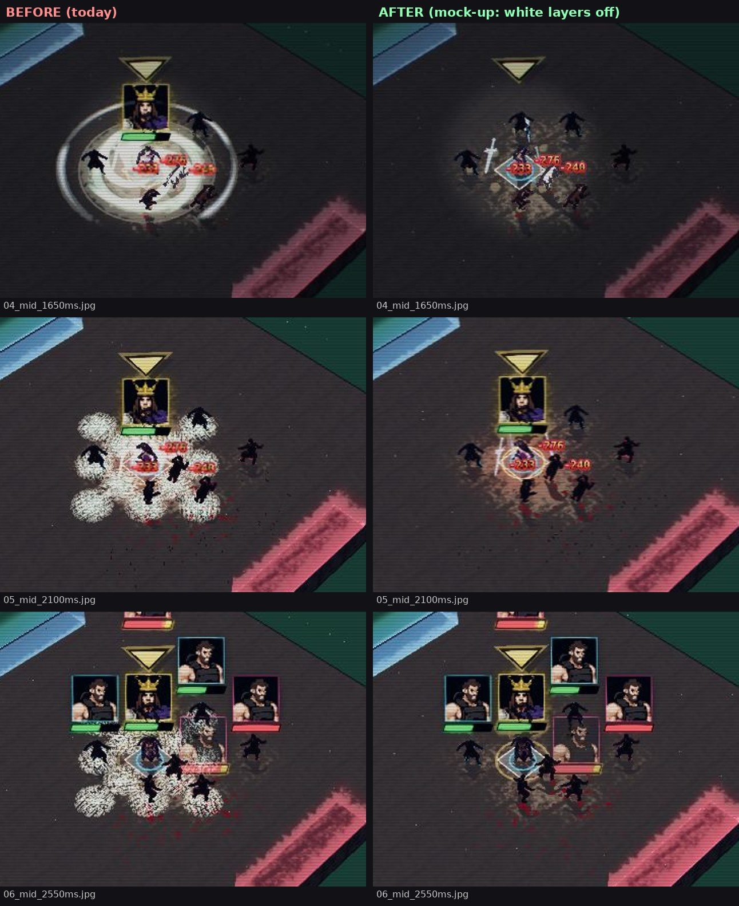
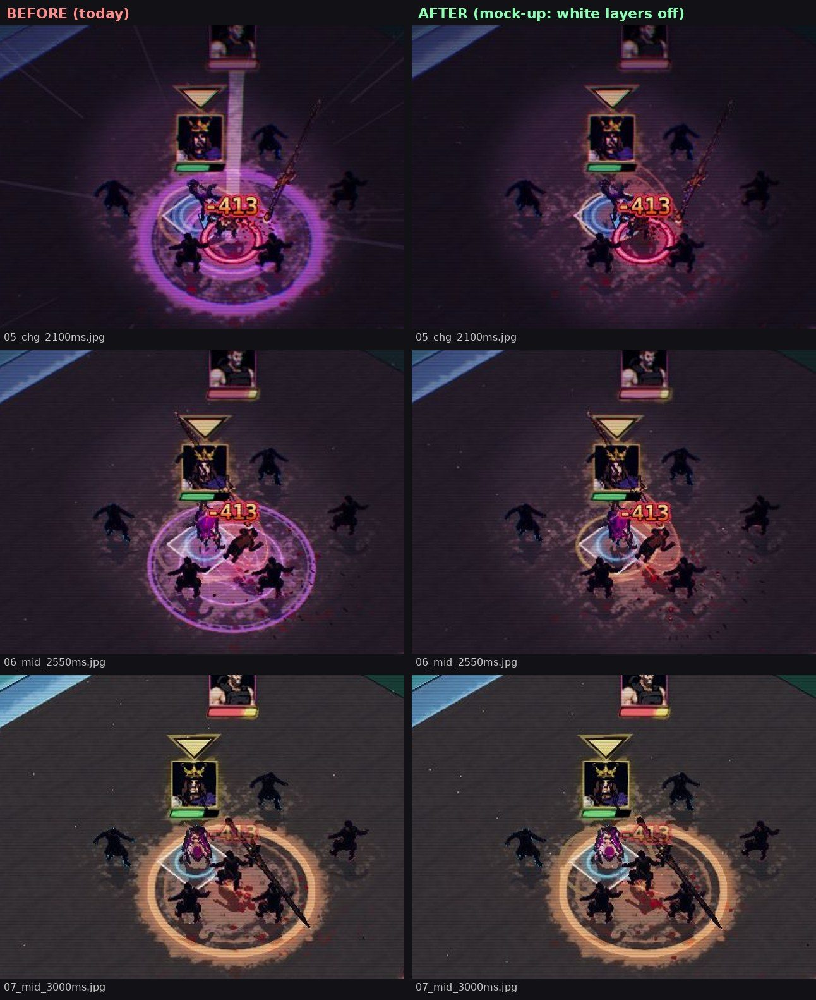
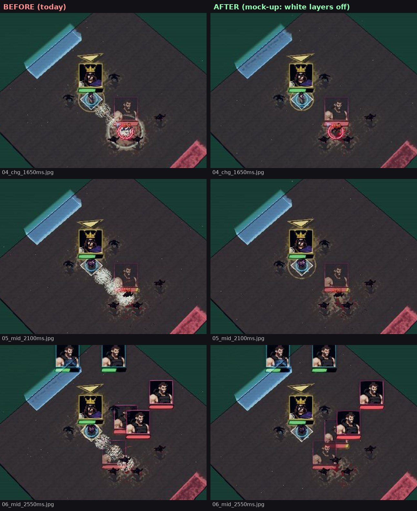
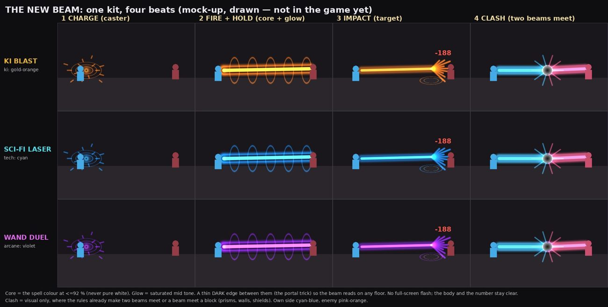
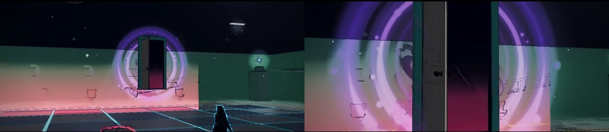

# VFX CLEANUP: take the generic white off every spell, a real beam kit, the portal look

**Status: STARTED 2026-11-17. B0 + B1 (the shared layers + the cast rune) are built; B2 onward are open. Section 10 = what mondo changed in the plan on 11-17 (no white meter, the runes) and where each batch stands.**
Asked by mondo on 2026-11-17 (thread "Clean up generic white spell VFX"):

> "Blade Waltz has a lot of white vfx that i think takes away from the spell, like i can hardly even see the sword or the
> sword slashes. Same thing with sword beam, just a lot of generic white vfx stuff going on, and the beam looks bad ... take
> out all of these generic basic white vfx that crowd the screen and the animations and either replace them or just leave
> them be because the spell might not need it anyway. Yes go through all 800 spells ... We need better beams and lasers,
> think epic anime ki blast or scifi laser blasters or harry potter spell duels. Also the portal from the cutscene that the
> door with kit and the shadow entities arrive out of, i like the look of that portal and that technique or look should be
> incorporated into more vfx. Make a plan doc first and then ill get fable to do it and test with screenshots"
>
> and: "the orange red slashes looked good and i want to keep"

Files in this folder:
- `VFX_CLEANUP_PLAN.md` (this) · `SPELL_TABLE.md` (all 986 castable spells: the white layers found on each, its rule, its batch)
- `batches/<batch>.txt` (spell ids, one per line, ready for the capture harness) · `img/` (the frames below)
- `tools/` (the audit script, the table writer, the throwaway mock-up patch) and `tools/harness/` (THE CAPTURE HARNESS, whole, launching through
  `probe-fast.js`). Repo-only reference, never uploaded to R2.

---

## 1. What the white actually is (the audit)

Every spell's look is several layers stacked by different passes, most of them added for ALL spells at once. The spell's
own look (its signature) is only one of them. The white mostly comes from the shared layers, which is why it is everywhere.
Line numbers are `three-vfx-effects.js` at main `da261dc`.

| # | Shared layer (where) | What it draws | Spells it reaches |
|---|---|---|---|
| W1 | **The stage burst** `_stageBurst` (23048), fired on every cast's hit beat | a full-screen flash (holed round the target), rush lines (heavy+), a shock ring, a crescent cut (slash archetypes), sparks, a "speed burst" starburst (physical hits), a second crescent + an aftershock ring (heavy+), a capstone bloom and a light pillar (divine) | every non-support spell: **842**. Rush lines 331, speed burst 318, aftershock 331, crescent 71, pillar 26 |
| W2 | **The pale palettes** `_STAGE_ARCHETYPES` (21954) | each archetype's `flash` colour is also the colour three-vfx.js gives EVERY untinted flash particle of that spell (`_rvApply`, three-vfx.js 235) | 22 of 32 archetypes are near-white (wind, metal, lightning, divine, ice, water, tech, kinetic, human, heal, mana, aura, ki, sonic, psychic, mind, hex, rig, anomaly ...). Lightning's ring is pure `0xffffff`; metal's ring + flash + lines are all near-white |
| W3 | **The noise wash** `_nzStage` (62571), table `_NZ` (62513) | a splat of pack noise on every square a damage spell hits | wind `0xeafff6`, metal `0xeef4fa`, sonic `0xffe6f8` and ice `0xbff2ff` are near-white: on Blade Waltz it is 13 white static blobs, on Sword Beam a white static stripe |
| W4 | **White baked into shared signature helpers** | `_sigSlashCombo3D` (13557) heavy finisher: white screen flash + white speed burst + white crescent + rush lines (used by Dragon Slash, Brave Charge, Cross Slash, Sneak Slash, Red Slash, Synthetic Blade). `_sigCrescentSlash3D` (10477): a white-hot glint rides every arc's tip (30 call sites + every slash stage + the metal stamp). `_sigSpeedBurst3D` called with `0xffffff` 11 times; `_sigScreenFlash` called with white / near-white 74 times | 615 spells have their own look; **367** of them carry white colours in it, 87 flash the screen |
| W5 | **Flash layers in the particle recipes** (`EFFECTS[...]`, 1,583 recipes) | a `flash` sprite on the impact, untinted or tinted near-white; an area spell repeats it on EVERY square (Blade Waltz: 13) | 277 spells; 141 also have an untinted white shockwave / halo ring |
| W6 | **The generic laser** `_spawnLaserBeam3D` (6385) via `_fireBeamMapped` (5024) | white core cylinder + glow + energy sheath + 3 rings, and an untinted white `flash` at the caster as the "charge" | 25 line spells (list in section 4) |
| W7 | **Element stamps** | the metal stamp's glints (`_mtlStage` 57575, `_MTL.glint`), the wind gather + mark (`_wdStage` 54542), sonic rings | every metal / wind / sonic spell |

**What stays (not generic clutter, or he asked for it):**
- **THE HIT BLINK** (the victim's body flashes white during the hit stop): mondo asked for it 11-04 ("like pokemon or fire
  emblem where they flash all white a couple times"). It is the body, not a layer over it. Keep.
- **The orange-red slash scars** (`_crSlashScar` 41891, default `0xff2414`) and Dragon Slash's orange slash combo. He likes
  them. Keep and lean on them.
- The damage numbers, the team rims (Riot phase C), the true-area line (phase D), the action tile glow, the hit stop shake.

### His three examples, today vs the mock-up

The mock-ups are real game frames (same board, same caster, same cast) with a throwaway local patch that switches the
white layers off for these three spells (`tools/mockpatch.py`, never committed). Nothing new was added in them.

**Blade Waltz**: today a white disc + white ring cover the spin, then 13 white static blobs (the wind noise wash on every
square of the diamond) sit over the bodies. With the white off you can see the three blades and the cuts.

**Dragon Slash**: today a white pillar, white rush lines and the purple "unholy" rings + aftershock stack over the orange
slash combo. With them off, the orange slashes and the sword carry the spell on their own.

**Sword Beam**: today the "beam" is a white static stripe (the wind wash) plus the generic laser under a pale crescent.
With the white off there is almost nothing left, which is the real problem: it needs the new beam (section 4).

---

## 2. The rules (what Fable applies to every spell)

**The one test:** in the hit frame, can you see the caster, the target, the hit and the number, and does every bright thing
on screen belong to THIS spell (its element, its weapon, its prop)? If a bright thing would look the same on any spell, it
is generic: it goes, or it becomes this spell's own colour and shape.

Each spell gets one of four calls (the table's starting call; the batch confirms it on the before sheet):

| Call | When | What changes |
|---|---|---|
| **STRIP** (548) | it has its own look (a signature, a prop, a bespoke recipe) | take the generic white off (W1 reduced to grade + shake + tile glow, its white bits of W4, per-square W5 flashes). Add nothing. Most spells need nothing more. |
| **REPLACE** (315) | no own look; the generic burst IS its look | the stage burst stays as its look but in the spell's own mid-tone colour (never near-white), one accent that says what it is (an ember, a leaf, a cog, a note), at most one flash, never per square |
| **BEAM** (25) | a line spell on the generic laser | moves onto the new beam kit (section 4) |
| **LEAVE** (98) | heals / buffs / hexes with no white in them | nothing; the sheet just confirms it |

**White means the generic layers, not the colour (mondo 11-17).** The target is the shared white VFX that every spell
gets, the ones section 1 traced in the code. A thing that is white because it IS the thing stays: THE HIT BLINK (the
victim's body flashing white), a snow spell's snow, a holy spell's own light shape, the damage numbers.

**Hard limits (all calls):**
1. **No pure white** on any spell layer. A hot core takes the spell's colour with its brightest channel at or under 92 %
   (the Riot value rule already in three-vfx.js `_RV_VALUE_MAX`). White is reserved for the hit blink.
2. **One flash per hit square**, body-sized or smaller, on the impact frame only. **An area spell flashes EVERY square it
   hits** (mondo 11-17: "that is the whole point of the flash to show where the damage hits"); the flash takes the spell's
   colour, it is not removed.
3. **No full-screen flash** on STRIP spells. On REPLACE spells only on heavy + ultimate, in the element colour, and it keeps
   its hole round the target (it already does).
4. **Rush lines and speed bursts** only where the spell's own look calls for them (a finisher, a ki attack), never as the
   default for "physical".
5. His standing rules: own side cyan-blue / enemy pink-orange for team reads (Riot phase C), never hide caster / target /
   hit / number, bloom + fog stay OFF, basic attacks never use the fist sprite, never invent spells, never remove a spell.
6. Online: nothing new on `state`, nothing new to relay. Every layer here rides `fire()`, which online.js already relays,
   so the guest draws the same. A new beam beat or a clash must be decided from data both screens have (the beam's path,
   the board's objects), never from a random roll on one screen.

**A shared switch for the whole job:** `window.EW_NO_VFX_CLEANUP = true` puts every changed layer back to today's look (the
before shots use it in the same run, the way `EW_NO_RIOT_VFX` worked). Fable adds it in B0.

---

## 3. The shared changes (B1, the big lever)

Most of the cleanup is a handful of shared functions. Doing these first fixes hundreds of spells at once; the per-spell
batches after it are mostly checking and small fixes.

1. **The stage burst becomes a fallback** (`_stageBurst`). If the spell has its own look (`_geom3D(id)`, a G-O / P-Z /
   FX-2 signature, or a bespoke impact recipe), the burst keeps only the grade, the shake and the tile glow. If it has none,
   the burst stays, in the archetype's new mid-tone colour, with no speed burst unless the archetype is `ki` / `kinetic`.
   The capstone bloom and the divine light pillar stay only on spells with no own look.
2. **The palettes lose their white** (`_STAGE_ARCHETYPES` + `_STAGE_ARCHETYPES.wind` at 54557 and the other element
   passes that add their own). Every `flash`, `ring` and `lineColor` becomes a saturated mid tone of its element
   (for example wind `#a8ecd0` / `0xbff5df` / `#e4fff4` to a clear mint-teal, metal to a cool steel blue, lightning's ring
   `0xffffff` to electric blue, divine to gold). This one change recolours every untinted flash particle in the game,
   because three-vfx.js tints them from this colour.
3. **The noise wash** (`_NZ`): wind, metal, sonic and ice get their mid tones (keep the wash: he OK'd it 11-12). Blade
   spells skip the wash: their scar is their mark.
4. **`_sigCrescentSlash3D`**: the white tip glint takes the arc's own colour (or `noGlint` where the arc is already hot).
5. **`_sigSlashCombo3D` heavy finisher**: the white screen flash, white speed burst and white third crescent become the
   combo's own `glowColor`; rush lines only on capstones. Dragon Slash's orange stays exactly as it is.
6. **`_sigSpeedBurst3D` / `_sigScreenFlash` / `_sigShockRing3D`** callers that pass white get the spell's colour. The
   helpers themselves refuse near-white input when the cleanup is on (fall back to the caller's spell palette).
7. **Element stamps**: metal glints, wind gather + mark, sonic rings in their element mid tones.
8. **The cast rune** (mondo 11-17: "these runes that get drawn alot underneath the player ... a simple healing spell
   doesnt need a god damn satanic green rune underneath it. that should be preserved for magic spells where it makes
   sense. and it also clashes with the abstact/noise textures that get drawn on damaging tiles"). Traced: `_stageWindup`
   drew `_sigMagicCircle3D` under the caster of EVERY non-physical spell whose archetype has `glyph: true` (arcane, fire,
   divine, unholy, anomaly, heal, mana, hex, mind, aura, psychic, blood): 377 spells. Now only the schools whose magic is
   drawn on the ground keep it (`_VC_RUNE`: arcane, unholy, hex, blood, divine; 147 spells), and never when the cast's own
   squares lie on or beside the caster (a self-centred area: the rune sat under the noise wash). A spell's OWN circle (60
   `_sigMagicCircle3D` calls inside signatures) is checked spell by spell in the sweeps with the same two questions:
   is this magic that draws on the ground, and does it sit under a noise wash.

Proof for B1: one sheet of 16 spells across all archetypes, before (switch on) / after, plus the white meter (section 7).

---

## 4. The new beam and laser kit (B3 + B4)

### What is wrong today
The generic laser is a thin white cylinder with a glow, three rings riding it and a white blob at the caster for a
"charge". It has no wind-up, no weight, no impact of its own, and every line spell that falls back to it looks the same.
25 spells use it:

> Railgun, Sword Beam, Flamethrower, Gale, Ball Lightning, Crosswind, Bone Lance, Sonic Breaker, Water Pulse, Chart Topper,
> Timber!, Heat Ray, Baleful Gaze, Plasma Cannon, Entropic Beam, Heat Vision, Shockwave Clap, Freeze Breath, Orichalcum
> Ray, Ki Wave, Psychic Beam, Bullet Pass, Piercing Arrow, Black Tendrils, Judgment Beam

(Some of these, for example Gale, Piercing Arrow and Flamethrower, already draw their own piece ON TOP of the laser; for
those the laser just goes.)

### The kit: one function, four beats, three styles

`_beamKit3D(fromX, fromY, hitTiles, style, params)` in three-vfx-effects.js, called from `_fireBeamMapped` in place of
`_spawnLaserBeam3D` when a beam def names `kit: '<style>'`. Same inputs as today (the caster, the 3D line's start / end
points, the hit tiles), same timing hooks battle.js already reads (`beamFrontMs`, the hit lands when the front reaches a
body), so the camera grammar and the damage numbers line up with no battle.js change.

| Beat | What it draws | Notes |
|---|---|---|
| **1 CHARGE** at the hand (the cast's windup, 250-700 ms by weight) | rings that converge on the hand, motes pulled in, a small hot ball growing, a DARK pinch at its centre | the windup beat already exists (`_fireStage('windup')`), so the charge rides it and the guest gets it |
| **2 FIRE + HOLD** | the front lances out (ease-out), then holds: a hot core in the spell colour (<= 92 %), a wider saturated glow, a thin dark edge between them so it reads on a bright floor, bands spiralling down the length, a muzzle bloom at the hand | the dark edge is the portal's trick (section 5): contrast, not brightness |
| **3 IMPACT** | a splash cone thrown BACK off the body, a ring flat on the floor, the element's mark (scorch, frost, scar) on each struck square; no white flash | the body and its number stay clear (the splash goes behind and to the sides) |
| **4 CLASH** (see below) | where a beam meets another beam or a block: both colours push at a dark seam with a turning ring, sparks of both colours | visual only |

**Three example styles** (starting points; a spell that fits none gets its own; colours come from the spell's element / palette):
- **`ki`** (anime ki blast: Ki Wave, Spirit Bomb, Ki Volley): a long two-handed charge, a thick beam with a
  heavy front ball, a screen shake on fire, the ground scoured along the line.
- **`blaster`** (sci-fi: Railgun, Plasma Cannon, Heat Ray, Heat Vision, Orichalcum Ray): short charge with a whine-up of
  rings, a narrow very bright core, a quick hold, bolt-style pulses for the rapid ones (the gatling kit stays for bullets).
- **`wand`** (spell duel: Psychic Beam, Entropic Beam, Baleful Gaze, Black Tendrils, the high wizardry family): a wavy,
  slightly unstable stream with sparks peeling off it, a small charge at the wand / hand, a crackling front.
- Sword Beam joins the Swordmaster's language (mondo 11-17: "match the sword cuts"): an orange-red crescent wave that
  leaves the red scars down the line.
- These styles are EXAMPLES (mondo 11-17), not categories: each spell gets the look that fits it.

### The clash (visual only, no new rule)
Two beams never fire at the same moment in this game, so the clash is drawn where a beam's path already meets something
the rules make it stop at or bounce off:
- a **prism / mirror** (Pulse Lattice, Prism, Place Mirror, the ricochet spells): the incoming beam and the bounced one meet
  at the prism in a clash knot;
- a **wall or blocker** that stops a beam (the beam boring rules in battle.js) and a **shield / barrier / guard** on the
  target: the beam pushes against it for its hold, then the impact;
- **finishers / executions** that stage two sides (already scripted), where a director wants it.

A real beam-vs-beam struggle as a game rule (two casters, a mash, a winner) would be a NEW RULE, so it is not in this plan.
If mondo wants one, it is his call and its own plan.

### B4 (part 2): blasts, bolts and duels
The same kit's charge + front ball + impact on the projectile spells that are really blasts (ki attacks, magic missile,
plasma shots, zaps, rays; 16 in `batches/B4.txt`, for example Spirit Bomb, Ki Volley, Ki Charge, Space Laser, Stun Ray, Love Ray, Zap Zap Zap). A bolt = a beam whose front is the whole beam (a short glowing
slug with a trail), so the look matches the beams.

### Sight lasers and the turret blast (mondo 11-17: "those are lasers too")
These are not spells in the table, but they are lasers on the same board and go into B3 with the kit.

| What | Where it is drawn today | What is wrong |
|---|---|---|
| **The turret's sight laser** (a turret locks the nearest enemy in range) | three-renderer.js `_updateTurretAim` + `_updateLaserSightBeams` / `_buildLaserEntry` (~29360-29600): a thin red additive cylinder `0xff2222`, a faint glow, a dot, pulsing | a flat rod with no source and no lock beat; same look whether it is aiming at you or for you |
| **Take Aim's sight** (`headshot`, the delayed mark: the shot waits a round in `state._delayedSpells`) | the same `_updateLaserSightBeams` | same |
| **The gun rig's sniper laser** (gun spells fired from the hand) | three-vfx-effects.js `_sigGunRig3D` (~14760, plane `0xff4455` until the first round) | a second, different red line for the same idea |
| **The turret blast** (the end-of-round turret shot) | battle.js fires `fire('beam', '_turretBlast')`; `EFFECTS._turretBlast_beam` = 6 gatling tracers (`_crGatling` ~42165) with an untinted white `flash` head, and `_turretBlast_impact` = a white flash on the body + red sparks | the white head + white hit flash are generic; the shot has no charge at the barrel |
| Ray guns in the gun rig (`opts.ray`: Love / Stun / Goop / Shrink Ray) | `_sigGunRig3D`: a pure white core `0xffffff` in a coloured sleeve | white core; these are in B4 |

**The plan:**
- **One sight laser** for all three (turret, Take Aim, the sniper rig): it starts at the real muzzle / scope, a thin hot
  core + glow with the kit's dark edge, a dot on the body with a small ring, and a **lock beat**: the line sweeps and
  wobbles while it searches, then snaps steady, the dot tightens and ticks once (Take Aim holds locked until the shot
  lands next round). Fog rule unchanged: only drawn where the viewer's own sight sees it (it already checks).
- **Its colour (mondo 11-17, decided):** cyan-blue for your own / friendly sights (turret, Take Aim, sniper rig), red-pink
  for an enemy's, from the viewer's seat (the Riot team colours). The guest sees its own side cyan too.
- **The turret blast** goes on the kit's `blaster` style: a short charge of rings at the barrel while the sight locks, then
  the six-round pulse train (kept, it is the look) with a hot red-orange core at 92 % (no white head), each round landing
  as sparks + a small scorch on the body, the number clear. The kick of the barrel stays.
- Proof (B3): a VS-CPU board with a deployed turret and a Take Aim cast: the search, the lock, the fire and the hit, before
  and after, plus the same from the guest's seat online (the turret shot is host-run and relayed: check it still draws).

---

## 5. The portal look (B5)

### What he likes

It is **THE AIR DOOR**: three-vfx-effects.js `_sigAirDoor3D` (26460), called by battle.js `_questDoorUp` (61950) from the
first quest's ambush cutscene and fight (the door Kit and the two Shadow Entities come through). Its technique:
1. **Counter-turning rings, not a flat glow**: two ring planes (teal `_DOOR_FX.teal` and warm `_DOOR_FX.light`, the
   `_sigRingTex` texture) turning opposite ways, a soft glow plane behind, the group springing open with an ease-out-back.
2. **A dark centre**: the doorway's light dies to a black-violet void (`0x07040d`, NORMAL blend, not additive) as the menace
   builds, so the rings read against darkness instead of against white glare. This contrast is most of why it looks good.
3. **The bruise**: over 3 s the rings shift teal to violet (`0x7a3cff` / `0x3a1466`), spin faster and throb.
4. **Smoke that falls out of it**: black smoke and soft smoke roll out of the doorway and DOWN (`_goSpray`), and sparks of
   the portal's own light crawl round the frame.
5. **A staged API**: form, emerge (the door scales up out of it), open (the leaf swings, the light pours), menace, close
   (it shrinks away). Each step can be driven by a beat.

### The plan
- **Pull the technique out into a kit**: `_portalKit3D(tx, ty, o)` (rings + void + bruise + falling smoke + staged
  open / close), built from `_sigAirDoor3D`'s own code; the air door then calls the kit, so the cutscene is unchanged
  (proof: the ambush frame before / after is the same).
- **Where it goes** (81 spells in `batches/B5.txt`; the obvious first ones):
  - Door Agent kit: the door spells (Gust / Archers' / Hell / Frost / Maw / Laser / Light / Shut Door, Door Dash, Swing
    Door, Trapdoor, Twin Doors, Breaking and Entering, Drop In). They already share the door rig (`_sigDoorRig3D`); they
    gain the rings + void when a door opens onto somewhere.
  - Teleports and escapes: Teleport, Instant Transmission, Shadow Step, Phase Walk, Void Rush, Mirror Blink, Rabbit Hole,
    Agent Vanish, Astral Projection, Spirit Walk, Abyssal Wings, Mist Form, Cryptid Vanish (a small portal at the leaving
    square and one at the arriving square, each in the caster's colours).
  - Summons: Summon Creation, The Gathering, Brood, Wolf Pack, Spirit Animal, Raise the Dead, the four weather summons (the
    thing comes OUT of a portal instead of popping in).
  - Rifts and voids: Shadow Realm, Into the Sack, Dimensional Fold, Dimensional Web, Black Hole, Singularity, Hell Door.
  - Hostile vs friendly: a friendly portal keeps the teal-to-warm look; a hostile one (an enemy's cast, from the viewer's
    seat) uses the bruise colours (pink-violet), which also fits the Riot team colours.
- **Its look also feeds the beams**: the dark edge inside the beam glow, and the clash's dark seam (section 4).

---

## 6. The batches for Fable

Every batch is one thread, one PR, merged + uploaded the normal way (RULE #1, `?v=` bump, `node sync-zip.js --upload`),
with the switch `EW_NO_VFX_CLEANUP` for its before shots. Batches after B1 can run in any order, but B3 before B4 and B5
after B1. The batch lists are `batches/<batch>.txt`; the per-spell detail is `SPELL_TABLE.md`.

| Batch | What | Spells | Proof | Model note |
|---|---|---|---|---|
| **B0** | The switch `EW_NO_VFX_CLEANUP`, the capture runner launching through `probe-fast.js` (`tools/harness/sv-run.js`). DONE 11-17. No white meter (section 10) | 0 | none | done |
| **B1** | The shared changes (section 3) + the cast rune. DONE 11-17 except item 7 (the element stamps go with their element's sweep, B7) | reaches ~840 | after frames of a spread of spells, looked at | the most important step: high effort, read section 1 first, look at every frame |
| **B2** | DONE 11-17 (section 10). Blades: his examples first (Blade Waltz, Dragon Slash), Brave Charge, Cross Slash, Sneak Slash, Red Slash, Synthetic Blade, Blessed Blade. Sword Beam gets its interim cleanup here and its beam in B3 | 9 | before / after per spell, the hit frame cropped to the target | medium-high effort; his orange-red stays |
| **B3** | The beam kit (section 4) + the 25 generic-laser spells + a check of the other line spells + the sight lasers (turret, Take Aim, sniper rig) and the turret blast | 47 + the turret / sight lasers | per style: the four beats in one strip; every converted spell's sheet | design work: high effort, the longest step |
| **B4** | Blasts, bolts, wand duels on the same kit + the clash beats | 16 | clash frame at a prism and at a shield | high effort |
| **B5** | The portal kit + the door / teleport / summon / rift spells | 81 | the ambush cutscene frame unchanged + before / after sheets | high effort |
| **B6a/b** | Light: divine, aura, heal, mana, lightning | 96 + 95 | overview sheets + meter, the worst 10 cropped | sweep: medium effort |
| **B7a/b** | Air and cold: ice, water, wind, metal, sonic | 74 + 74 | same | sweep: medium effort |
| **B8a/b** | Fire, earth, nature, poison, blood | 83 + 82 | same | sweep: medium effort |
| **B9a/b** | Mind and dark: arcane, psychic, hex, unholy, anomaly | 109 + 108 | same | sweep: medium effort |
| **B10** | Bodies and tech: human, kinetic, grapple, skyfall, rig, tech, alien | 112 | same | sweep: medium effort |
| **B11** | Final pass: every spell's sheet + the meter report, a real VS-CPU match and a 2-player online check that the guest sees the same | all | the report + online pair of frames | medium effort |

**Rules for every batch thread:**
- First `git fetch origin main && git merge origin/main` (RULE #1d) and `node fresh-check.js`.
- Read this plan, the batch's rows in `SPELL_TABLE.md`, and `docs/notes/spells-vfx.md` (the Riot pass, THE CLEAR BODIES,
  THE HIT BLINK) before touching a helper.
- What to remove comes from the CODE (the table + `tools/audit.js`), not from pictures (mondo 11-17). Fix, then shoot the
  batch AFTER in the harness and look at every frame yourself: the only question for a picture is whether the spell still
  reads well with the generic layers gone (not empty, not worse). A before frame (the switch) only when a comparison is
  needed to judge that. A spell whose after frame is worse is fixed or goes back for that spell, and is listed in the reply.
- Never delete a spell, its prop, its model or a signature: this is about layers. Never repaint his textures.
- Change the shared helper rather than 40 call sites, but never a helper's look for a spell outside the batch without
  saying so (B1 is the only batch that changes everything on purpose).
- `node --check three-vfx-effects.js` (and any other JS touched) before the PR. No tests, no CI (his rule).
- Notes: a section per batch in `docs/notes/spells-vfx.md` ("THE VFX CLEANUP, B<n>"), short.
- Reply to mondo: the after frames, the `[EW BUILD]` HEAD, the uploaded files + sha256[:8].

---

## 7. How each batch proves it (screenshots)

- **The harness is in the repo**: `docs/plans/vfx-cleanup/tools/harness/` (the 10-26 spell look audit, every file it
  needs, nothing from project files). `bash docs/plans/vfx-cleanup/tools/harness/setup.sh` once, then
  `node /tmp/sv/sv-run.js --ids docs/plans/vfx-cleanup/batches/<batch>.txt --out /tmp/sv/<batch>`, then
  `python3 /tmp/sv/sv-report.py /tmp/sv/<batch> --title <batch>` for the sheets. One real cast per spell on the spell
  audit board through the real HUD, frames every ~0.4 s. Both launchers (`sv-run.js` for batches, `sv-ctl.js`
  + `start.sh` + `e.sh` for one spell by hand) go through `probe-fast.js`, the project rule since 11-16. One browser at a time.
- **A before frame when one is needed**: `--opts` with `{"<id>": {"pre": "window.EW_NO_VFX_CLEANUP = true"}}`.
- **No white meter (mondo 11-17, section 10).** Nothing counts white pixels: what is generic is known from the code.
- **Pictures for mondo**: the hit frame cropped to caster + target, before left, after right (like `img/ba_*.jpg`), and the
  overview sheets in `/mnt/project-files/vfx-cleanup/<batch>/`.

---

## 8. Decisions from mondo (11-17)

1. **Sword Beam matches the sword cuts**: orange-red, the same colour as the Blade Waltz / Dragon Slash slashes and scars.
2. **The beam styles are examples, not boxes** ("they are not the bible"). ki / blaster / wand are three starting looks the
   kit can do; each beam spell gets the look that fits THAT spell (its name, race, element, prop), and a spell that fits
   none of them gets its own. Never force a spell into a category.
3. **The portal only where it makes sense** (his example: the Ringmaster calling an eagle does not need one). B5's list
   is candidates: a spell gets the portal only if something really comes through from somewhere else (rifts, raised dead,
   doors, teleports, void things); a creature that walks, flies or is thrown in keeps its own entrance.
4. **Sight lasers**: cyan-blue for own / friendly, red-pink for enemy, from the viewer's seat.
5. Open: a real beam-vs-beam struggle as a rule (not in this plan; only if he asks).

---

## 9. How this audit was made (for the batches to re-run)

- `tools/audit.js` loads data.js (through `load-data.js`) and three-vfx-effects.js in a Node vm with three.js stubbed, then
  for every spell: its stage archetype + weight (`ThreeVFXEffects.stageInfo`, the real resolver), which W1 parts fire,
  the flash / ring / sparkle layers of every recipe its `SPELL_MAP` row names (+ the per-square recipe), whether it rides
  the generic laser, and its signature's code read for white colours, screen flashes and speed bursts (the signature and
  every helper it calls). It reads code, it does not run the look, so a batch confirms each call on the sheet.
- `tools/table.js` writes `SPELL_TABLE.md` and `batches/*.txt` from it.
- `tools/mockpatch.py` is the throwaway patch used for the mock-up frames (applied, shot, reverted; never merged).
- Frames: same spell audit board, `?ew_gpu=webgl2`, Mesa llvmpipe, 1280 x 720. Main `da261dc`.

---

## 10. Changes to the plan on 11-17 (the build thread) + where the batches stand

**From mondo, 11-17, after reading the plan:**
1. **The hit blink is not part of this, and "white" is not the target.** "I am very specifically talking about the white
   vfx that are spammed on all the spells, not just anything that is white." See the note under the four calls in section 2.
2. **No white meter, no pictures to prove something is white.** "can you not just trace which white vfx are spammed a
   lot? ... it should just be in the code." The trace is section 1 + `SPELL_TABLE.md` + `tools/audit.js`. Pictures are only
   the after check (section 7).
3. **The runes** under the caster are generic clutter too: section 3 item 8.
4. **Every square an area spell hits keeps its flash** (hard limit 2). "i didnt want you to literally take out everything
   white."
5. **Every spell with no look of its own gets one** (the 315 REPLACE rows): "any spells that dont have a look of their own
   need one, start a thread or multiple threads to give them." A recoloured generic burst is the stopgap, not the answer.
   The threads: `docs/plans/vfx-cleanup/OWN_LOOK_BRIEF.md`.

**Built in B0 + B1 (three-vfx-effects.js, block "THE VFX CLEANUP, B0 + B1"):**
- `window.EW_NO_VFX_CLEANUP = true` = today's look back, live.
- `_vcOwn(spellId)` = the spell has its own look (the same test the audit used: 615 spells). Its stage burst is now the
  grade + the shake + its element's mark only.
- `_vcPal` = every damage archetype's ring / flash / rush-line / orb colour at a mid tone (saturation raised, value
  capped at 92 %), computed, so an archetype added later is covered. The support palettes (heal, mana, hex, aura ...) are kept.
- A spell with no own look: screen flash only on heavy + ultimate, rush lines only on an ultimate or a ki spell, the
  speed burst only on ki / kinetic.
- `_vcCol` = `_sigScreenFlash`, `_sigShockRing3D`, `_sigSpeedBurst3D`, `_sigCrescentSlash3D` handed near-white draw in the
  casting spell's colour. The crescent's tip glint takes the arc's colour (`noGlint` turns it off).
- `_sigSlashCombo3D`'s heavy finisher: flash, speed burst and third cut in the combo's own colour; rush lines on an ultimate only.
- (Taken back the same day: B1 first drew an area's outer squares without their flash. mondo: every hit square flashes.)
- The noise wash: every sheet at a mid tone; a blade spell gets no wash and no wind gust / mark (its scar is its mark).
- The cast rune: section 3 item 8.

**Built in B2 (the blades, 11-17):** Blade Waltz ends on its three cuts + the shake (its white third cut, white speed
burst, ring and blue screen flash are off). `_sigSlashCombo3D` (Dragon Slash, Brave Charge, Cross Slash, Sneak Slash, Red
Slash, Synthetic Blade, Blessed Blade): no summon circle, no opening screen flash, and the heavy finisher is the cut +
its ring + its scar (no screen flash, speed burst or rush lines). Sword Beam: the wave is the Swordmaster's orange-red
(`0xff5a2a`, core `0xffa060`), leaves a red scar + embers on every square down the line, and the generic laser + white
charge flash no longer draw under it. Its wave still crosses the line in 0.24 s: the real beam is B3.

**Corrected 11-17:** the own-look lists called 240 spells "no look". About 129 of them have their ELEMENT's pass (fire,
ice, water, nature, wind, metal, earth, sonic, blood, psychic) and only lack a spell-specific piece; 62 have no element
at all. The threads were told: bare ones first, the element pass is the base, add only what makes it that spell.

**Suggestions from the build thread (not decided; mondo's call):**
- Show mondo B2 (his three examples) before the element sweeps start, so the direction is checked on 9 spells, not 900.
- B3 is two jobs: the beam kit + the 25 laser spells (three-vfx-effects.js), and the sight lasers + the turret blast
  (three-renderer.js). Two threads would be safer than one.
- Re-run `tools/audit.js` + `tools/table.js` at the start of each batch: races added after 11-17 are not in the table.
- B11: delete the switch and the old branches once he has OK'd the look (the Riot switch is still in the code months later).
- The table covers castable spells only. Basic attacks, items and combo hits use some of the same helpers and should get
  one look in B10.
- An enemy's teleport portal (B5) at a square the viewer's fog hides must not draw (RULE #2).
- New beam beats (charge, hold) have no sound yet.
