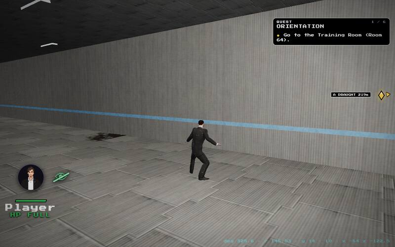
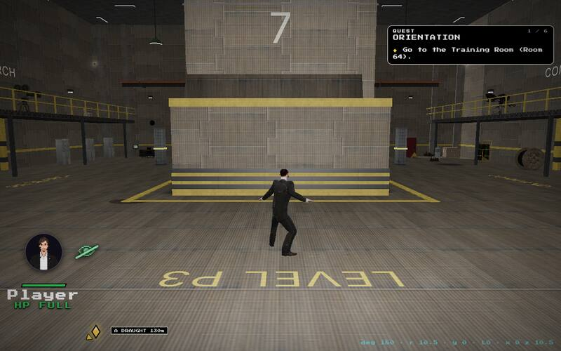
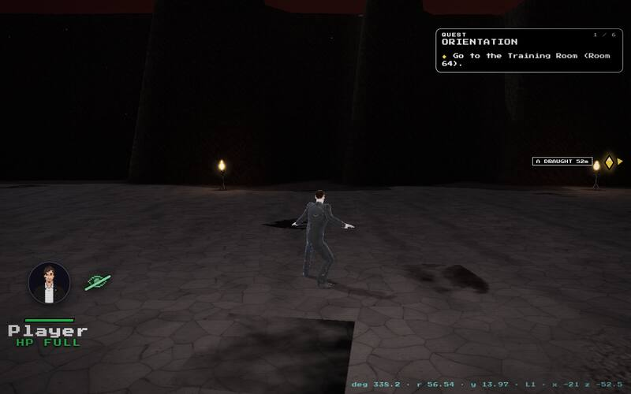
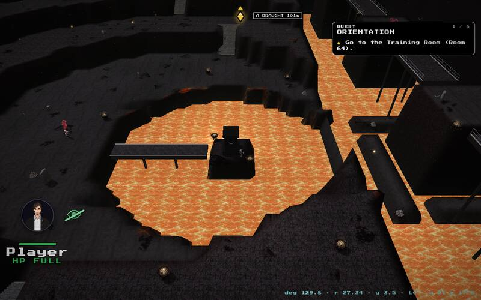
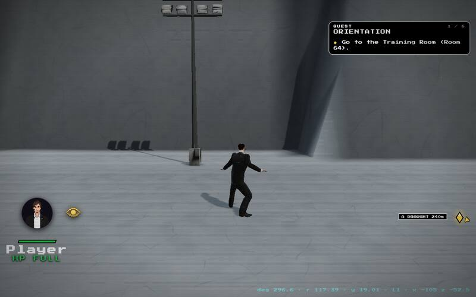
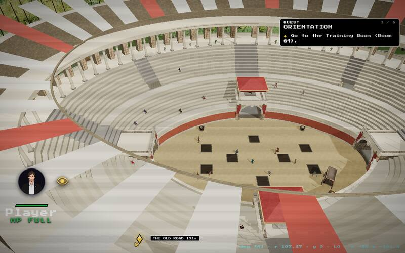
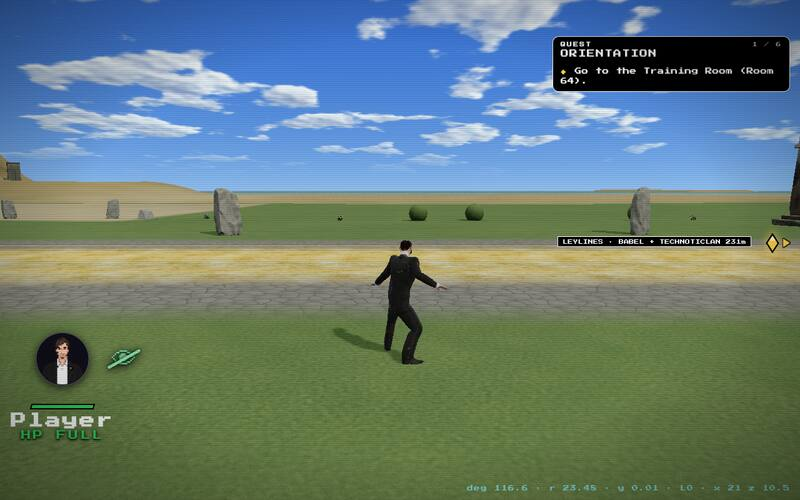
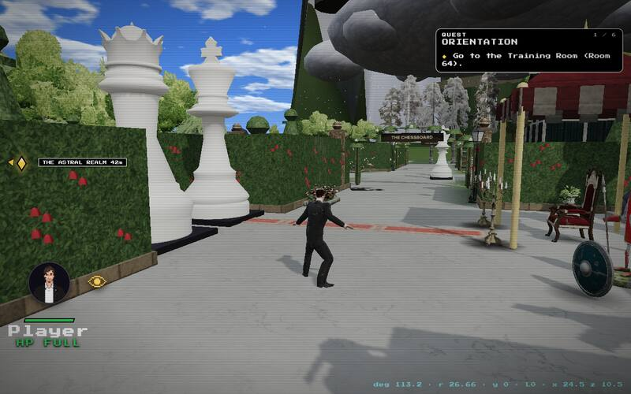
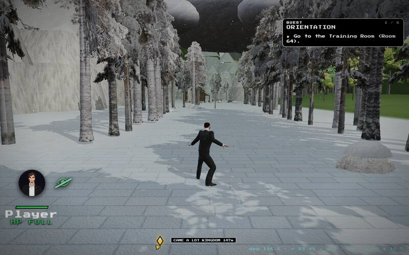
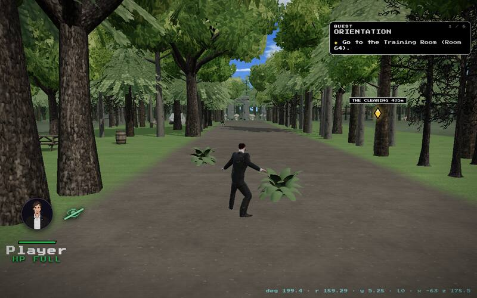

# THE SCREENSHOT AUDIT (2026-11-20): what the world looks like, place by place

mondo 11-20: "do a second audit of everything with screenshots first so we have a better starting reference point."
The first audit (`AUDIT_DATA.md`) measured the world in numbers. This one looks at it. **It is NOT finished** (mondo stopped the run: too slow).

## Where it stands

- **Taken: 323 of 406 pictures, 59 of 62 places**, in `pictures/<place>/<district>_<air|worst|best>.jpg` (800 x 500). `pictures/index.json` lists
  every one (place, district, plot, the plot's NEED score, where the camera stood). Three a district: `air` = from above, looking north;
  `worst` = on the ground at the plot the number audit scored worst; `best` = at the plot with the most pieces on it.
- **NOT TAKEN: Disaster City (30 pictures), the Sewers (17), the Moon / Outer Space (30), routes r1, r4, r5.** Disaster City is the gap that
  matters: thread 2 takes its own pictures first (`node docs/plans/world-polish/shoot.js site_prebuilt_downtown_streets`).
- **Looked at and written up below: about 200 pictures.** **Taken but NOT yet looked at** (a zone's thread looks at its own before it starts):
  Heaven, the Internet, the Astral Realm, the Deep (the citadel, rings, trench), the Beach (Harbour, Shore, Bermuda Triangle), Babel + Technoticlan,
  Mount Olympus, the Ski Lodge + Snowy Pass, the Estate's lake + corn + ranch, the Clearing + Dead Man's Cave, the Fairy Forest, the Cavern,
  Hollow Earth, Agartha, the four tunnels.
- The tool: `shoot.js` (its header says how it picks a view). One place takes 1 to 4 minutes; the whole world is over an hour, and a checkout
  that falls behind main mid-run gets the STALE page, so run it a zone at a time, never the whole world in one go.

## What the pictures say that the numbers did not

1. **The biggest problem is not height. It is EMPTY and UNREADABLE.** The D.U.M.B.'s halls, Antarctica's snow fields, the Ley Line, the
   Cloister and Hell's dark ground all have shape or room to spare and nothing in it, or nothing you can see.
2. **Light and colour are a problem of their own** the number audit cannot see: Hell is black on black; Antarctica is one grey-white.
3. **Big walls are blurry up close.** Came A Lot's castle, the Vatican's palace and domes wear one stretched stone picture; from 3 m it is mush.
4. **The places that work are dense and themed**, not tall: the Colosseum, the Looking-Glass Garden, the Circus, the giant flowers of Bug
   Colony, the North Pole's square, Volcano Island's village, Sub-Level 7. They are the models to copy.
5. **Straight walks exist** (mondo's "long straight boring pathways"): the Woods' trail district, the Snowy Pines' path, the Ley Line.

## Place by place (only what was looked at)

Verdict words: GOOD = leave; DRESS = shape fine, needs things in it; LIGHT = cannot be read; FLAT = wants the verticality pass; TIGHT = cramped.

| Zone | Place / district | Verdict | What the pictures show |
|---|---|---|---|
| Desert | Area 51, Giza, Western Town, The Circus | GOOD | Thread 1's work reads well; buildings well spaced; the Circus is dense and themed. Nothing new. |
| D.U.M.B. | CERN, The Ring | DRESS + FLAT (worst seen) | An empty grey hall: floor, wall, one blue stripe. |
| D.U.M.B. | Command | DRESS | Two tables and six chairs in a hall the size of a hangar. |
| D.U.M.B. | Level P3 | DRESS + FLAT | One police car, one train, a long rail; otherwise bare floor. |
| D.U.M.B. | Research | DRESS | Bare tiles, a few benches; the corridor has a wheelchair and nothing else. |
| D.U.M.B. | Sub-Level 7 | GOOD (the model) | Mezzanine with rails, the big numbered block, paint on the floor: it reads as a place. |
| Hell | The Bowl, The Descent, The Rim, The Walkways | LIGHT + DRESS | The shape is the best in the world (lava bowl, steps, walkways over lava) but off the lava it is black ground on black walls. Skull piles are the only dressing. Needs light (torches, lava glow on the rock), colour, landmarks. NO more height. |
| Vatican | The Catacombs | DRESS | A plain stone maze, one tomb, a few candles. Wants niches, bones, side chambers (it also grows to 12 plots). |
| Vatican | The Colosseum | GOOD (the best place seen) | Tiers, awnings, arena floor with trap doors, an arched way in. |
| Vatican | The Gardens | GOOD | Stepped hedge maze, trees, lamps. |
| Vatican | The Cloister | DRESS | A big blank paved yard with one well. |
| Vatican | The Square | DRESS (light) | Big and emptyish; true to the real one, but wants stalls or a crowd. |
| Vatican | The Palace, The Basilica | TIGHT + blurry | Two domes with a thin gap between them; domes and long walls wear a blurry stretched picture; windows are black holes. |
| Antarctica | The Ice Wall, The Hull in the Ice | DRESS | Plenty of height already (wall, ridges). The ground between is an empty one-colour plain: one floodlight, one yeti. |
| Antarctica | The Crevasse, The Polar Openings | DRESS (light) | Good steps and a bridge; thin dressing. |
| Antarctica | The Station, The Shelf Ice | GOOD | Huts well spaced; the wreck in the ice is a real landmark. |
| Leylines | The Ley Line | FLAT + DRESS | A flat strip of grass and sand, a yellow road, a few standing stones. The weakest of the zone. |
| Leylines | Stonehenge | GOOD | Stones, ring path, torches. A little flat. |
| Leylines | Bug Colony | GOOD / DRESS | The giant flowers and the hive tree are great; the rest is flat lawn. |
| Leylines | Göbekli Tepe | GOOD | The enclosures read well; they stand on flat sand. |
| Came A Lot | The Forest | **DONE 11-20 (thread 3)** | WAS: flat lawn, trees as walls, a big empty clearing, one camp. NOW: three plots wide, a hollow, a bluff with a hunters' stand, a brook, an old oak (`pictures/camelot_ow_forest/proof_three_plots_wide.jpg`; `_worst` / `_best` are the OLD room). |
| Came A Lot | The Snowy Pines | **DONE 11-20 (thread 3)** | WAS: flat snow, a straight path between tree rows; a hard square edge where snow meets grass at the room line. NOW: three plots wide in snow and snow pines, a ridge, a gully, a tarn (`pictures/camelot_ow_pines/proof_three_plots_wide.jpg`, `the-snowy-pines_air_after.jpg`; the `_worst` / `_best` pictures are the OLD room). |
| Came A Lot | The Looking-Glass Garden | GOOD (a model) | Hedges, giant chess pieces, the chessboard: dense and themed. |
| Came A Lot | The Castle | blurry | Imposing from afar; the walls are mush up close. |
| Came A Lot | The Village | **DONE 11-20 (thread 4)** | WAS: a narrow passage with graves in it between the Chapel and a house. NOW: an open churchyard; three stairs up to the wall walk (`pictures/camelot_kingdom/proof_village_thread4.jpg`). |
| Mountains | The North Pole village | GOOD | A cheery dense square; the outskirts are emptier and flat. |
| Mountains | Mount Shasta | GOOD | The lodge, the meadow, prayer flags; some relief. |
| Woods | The Redwood Trail | GOOD | Cliffs with snow, a yeti, boulders. |
| Woods | The Ritual Ground | GOOD | Camp, idol, graves under the trees. |
| Woods | the trail district ("L", the link plots) | FLAT + straight | One wide straight dirt road through trees: needs bends, branches, side glades. |
| Estate | The Haunted House + Graveyard | GOOD | House, fence, rows of graves, hedges. |
| Beach | Pirates' Cove | GOOD | Camp, flag, the wreck in the lagoon. |
| Beach | The Frozen Sea | DRESS (barest small place) | A flat grey ice sheet in the sea, a few bergs and seals. |
| Beach | Volcano Island | GOOD | Dense tiki village under the volcano. **Possible bug:** a tall cone wearing the water picture stands out of the sea (`pictures/bermuda_ow_volcano/the-ocean_worst.jpg`). |
| Deep | The Sea Floor | GOOD / dark | Wreck, kelp, creatures. Its `air` picture is useless (taken above the surface). |
| Routes (not this plan) | 14 of 17 | FLAT | For the highway thread: every route is flat; a road on a bend or a diagonal has blocky stair-step edges (dh3, dh4, r10, l6); thin dressing. Best: r6 (covered bridge, stream), r9 (gas station). A pirate stops you on forest route r3. |

## Pictures to look at first

| | |
|---|---|
|  the barest: CERN |  the same zone done right: Sub-Level 7 |
|  Hell, unreadable |  Hell's shape, from above |
|  Antarctica's empty field |  the best place seen |
|  the Ley Line |  a model: the Garden |
|  the Snowy Pines |  a long straight way |

## Pictures that came out wrong (retake when the zone's thread runs)

`area51_ow_giza/giza_worst` (camera inside a dune); `atlantis_ow_floor/the-sea-floor_air` (above the water); `vatican_plots/the-palace_best`
(jammed against a dome); the Cove's and r3's have a pirate's talk box over them; `camelot_ow_fairy` and `hollow_earth_cavern` were taken
before the room said it was ready.
